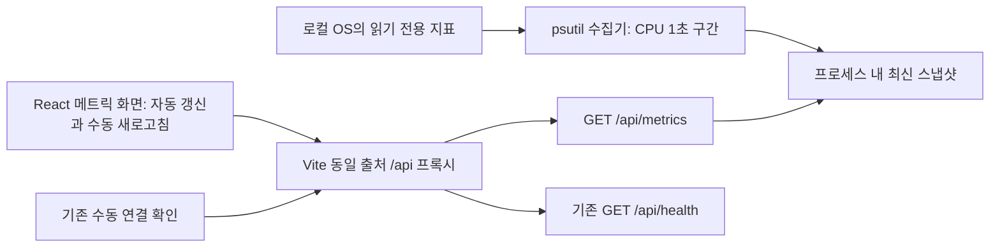

# InfraWatch Stage 1 설계

설계일: 2026-10-14. **설계만 확정한 문서이며 Stage 1 코드는 아직 없습니다.** 아래 JSON은 계약 설명용 예시로 실제 측정값이 아닙니다. 제품 화면은 구현 후 실제 수집 결과만 표시합니다.

Stage 0 기준 커밋: `701b2e934569d3cb327fa913a619296c18eedfcc` (`main`, `chore: establish InfraWatch stage 0 baseline`). 최초 커밋에 Stage 0 소스·문서 29개를 포함했고 커밋 직후 작업 트리는 깨끗했습니다. 이 문서와 README의 Stage 1 계획은 baseline 이후 변경으로 남깁니다.

## 1. 목표 및 범위

FastAPI가 실행되는 현재 로컬 시스템의 CPU, 메모리, 지정 파일시스템, 부팅 후 경과 시간, 수집 시각 및 공개용 호스트 식별 정보를 React 화면에서 확인합니다. 우선 지원·실측 완료 대상은 현재 macOS / CPython 3.14.4 / arm64입니다. Linux·Windows는 같은 계약을 사용할 수 있도록 설계하지만 구현 단계에서 별도 검증하기 전 지원 완료로 선언하지 않습니다.

기존 독립 앱 팩토리, health 요청·응답, 수동 연결 재확인, 테스트를 유지합니다. 실제 기존 경로는 `GET /api/health`이며 요청의 `/health` 표현은 이 경로를 뜻하는 것으로 해석합니다. `/health` 별칭을 새로 만들거나 경로를 바꾸지 않습니다.

Stage 1에 포함하지 않는 기능은 DB·이력 저장, 네트워크 수집, 프로세스별 목록, 인증, 다중 서버·원격 에이전트, 임의 명령 실행, 장애 알림, WebSocket, 차트 라이브러리입니다. 향후 기능을 위한 대규모 계층이나 플러그인 구조도 만들지 않습니다.

## 2. 아키텍처 구성



수집은 요청과 분리합니다. 앱 lifespan이 수집 서비스 한 개와 전용 실행 스레드 한 개를 소유하고, 클라이언트 요청은 캐시된 스냅샷만 읽습니다. 동시 탭·수동 새로고침이 CPU 측정 횟수를 늘리지 않습니다. 첫 수집 완료 전에도 health는 즉시 응답합니다.

Stage 1 실행 모델은 **Uvicorn worker 1개**입니다. 여러 worker는 각각 독립 캐시·수집기를 만들므로 지원 대상으로 삼지 않습니다. 개발 reload에서는 이전 lifespan의 종료와 새 lifespan 시작을 검증합니다. 서비스·캐시·작업 상태를 모듈 전역에 공유하지 않고 `create_app()`마다 생성해 테스트 독립성을 지킵니다. production의 별도 역방향 프록시는 기존 운영 제약으로 유지합니다.

## 3. 디렉터리 및 모듈 설계

아래는 구현 승인 후 만들거나 수정할 파일입니다. 이번 작업에서는 생성하지 않습니다.

```text
backend/app/
  main.py                  # 기존 health·오류 처리 유지, lifespan 및 metrics route 연결
  metrics.py               # Pydantic 계약, psutil adapter, 수집 서비스·캐시
backend/tests/
  test_health.py           # 기존 3개 보존
  test_metrics.py          # provider·clock을 주입하는 단위/계약 테스트
  test_metrics_live.py     # opt-in 실측 smoke test
frontend/src/
  App.tsx                  # 기존 연결 카드 유지, 메트릭 패널 배치
  api.ts                   # 기존 checkHealth 유지, metrics 요청·런타임 검증 추가
  metrics.ts               # TypeScript 타입, 숫자·단위 표시 함수
  useMetrics.ts            # polling·timeout·중복 요청·정리 수명 관리
  MetricsPanel.tsx         # 카드·시각·로딩·오류·이전 값 표시
  MetricsPanel.test.tsx
  useMetrics.test.tsx
  App.test.tsx             # 기존 6개 보존
```

처음에는 백엔드 기능 모듈 하나로 시작합니다. provider와 UTC/monotonic clock은 주입 가능한 경계로 두고 OS 호출만 교체할 수 있게 합니다. FastAPI 의존성에서 `app.state`의 수집 서비스를 참조해 endpoint 테스트는 실제 OS 작업 없이 실행합니다. 이 모듈이 실제로 커지거나 다중 서버 요구가 확정되면 나눕니다.

## 4. API 엔드포인트와 응답 계약

### 기존 health

`GET /api/health` → HTTP 200, 기존 JSON을 정확히 유지합니다.

```json
{ "status": "ok", "service": "InfraWatch" }
```

수집 실패는 health 실패로 변환하지 않습니다. health는 서비스 응답 가능 여부, metrics는 데이터 수집 가능 여부를 나타냅니다.

### 메트릭 조회

`GET /api/metrics`를 추가하는 것으로 계약을 확정합니다. host·path·command·interval을 받는 query/body는 없습니다. 공개 계약에는 수집을 강제로 실행하는 POST나 원격 대상 선택 기능이 없습니다. 응답에는 `Cache-Control: no-store`를 설정해 브라우저 HTTP 캐시를 쓰지 않습니다. 백엔드 수집 스냅샷 캐시는 별개입니다.

HTTP 200 예시 — **설계용 예시**:

```json
{
  "schema_version": 1,
  "status": "ok",
  "host": {
    "id": "local",
    "label": "Local system",
    "platform": "darwin",
    "scope": "local_system"
  },
  "collected_at": "2026-10-14T02:00:00.000Z",
  "age_seconds": 0.2,
  "collection_interval_seconds": 5,
  "metrics": {
    "cpu": {
      "usage_percent": 25.0,
      "measurement_window_ms": 1001
    },
    "memory": {
      "total_bytes": 8589934592,
      "used_bytes": 3221225472,
      "available_bytes": 5368709120,
      "usage_percent": 37.5
    },
    "disk": {
      "target_id": "primary",
      "total_bytes": 107374182400,
      "used_bytes": 53687091200,
      "free_bytes": 48318382080,
      "usage_percent": 52.6
    },
    "uptime": {
      "seconds": 3600,
      "booted_at": "2026-10-14T01:00:00.000Z"
    }
  },
  "errors": []
}
```

### 스키마 규칙

| 필드                           | 타입·제약                           | 의미                                                             |
| ------------------------------ | ----------------------------------- | ---------------------------------------------------------------- |
| schema_version                 | 정수 리터럴 1                       | 계약 버전. 의미·단위 변경 시 버전 변경 검토                      |
| status                         | `ok` 또는 `partial`                 | 네 자원 전부 유효 / 하나 이상 유효하고 일부 실패                 |
| host.id                        | 1–64자 `[a-z0-9_-]`                 | 기본 `local`, 공개 가능한 설정 식별자                            |
| host.label                     | 1–80자 문자열                       | 기본 `Local system`, 공개용 표시 이름                            |
| host.platform                  | `darwin`, `linux`, `win32`, `other` | `sys.platform`을 이 값으로 정규화                                |
| host.scope                     | 리터럴 `local_system`               | 백엔드 프로세스가 관측 가능한 OS 환경                            |
| collected_at                   | UTC RFC 3339, 밀리초, `Z`           | 최신 수집 시도 완료 시각. 네 지표의 원자적 동시 측정 시각은 아님 |
| age_seconds                    | 유한 비음수 number, 소수 1자리      | 서버 monotonic clock 기준 완료 이후 경과 시간                    |
| collection_interval_seconds    | 정수 리터럴 5                       | 수집 시작의 목표 간격                                            |
| metrics.cpu/memory/disk/uptime | 위 구조 또는 `null`                 | 실패한 자원만 null; 이전 값을 섞지 않음                          |
| usage_percent                  | 유한 number, 0–100 포함, 소수 1자리 | 측정 정의는 5절 참조                                             |
| measurement_window_ms          | 양의 정수                           | CPU 호출을 둘러싼 실제 monotonic 경과 ms                         |
| \*\_bytes                      | 정수 0–9007199254740991             | JSON/TypeScript 안전 정수 범위, total은 >0                       |
| uptime.seconds                 | 비음수 안전 정수                    | 부팅 이후 경과 초, 내림                                          |
| uptime.booted_at               | UTC RFC 3339, 밀리초, `Z`           | OS boot time을 UTC로 변환                                        |
| disk.target_id                 | 리터럴 `primary`                    | 서버 내부 설정 경로의 공개 식별자; 원본 경로 비공개              |
| errors                         | 배열                                | 실패 자원당 정확히 1개; 정상 응답에서는 빈 배열                  |

Pydantic은 strict number/정수·enum·유한성·범위와 자원 간 관계를 검증하고, 내부 응답 모델은 추가 필드를 금지합니다. 클라이언트도 `unknown`부터 검증하며 문자열 숫자·boolean·누락·NaN/Infinity·범위 밖 값·잘못된 상태 조합은 계약 오류로 처리합니다. 외부 응답의 알려지지 않은 추가 필드는 무시할 수 있지만 필수 필드·버전·의미가 틀리면 거부합니다. JSON의 `25.0`이 `25`로 직렬화되더라도 숫자 값은 동일하며 소수 자리 표시는 UI 책임입니다.

### 부분 수집 실패

디스크만 실패하면 HTTP 200, `status: "partial"`, `metrics.disk: null`, 나머지는 **동일 수집 시도의 값**을 반환합니다. 아래는 앞의 예시에서 달라지는 부분만 설명한 것으로 별도 완전 응답은 아닙니다.

```json
{
  "status": "partial",
  "metrics": { "disk": null },
  "errors": [
    {
      "resource": "disk",
      "code": "COLLECTION_FAILED",
      "message": "Disk metrics unavailable"
    }
  ]
}
```

`resource`는 `cpu|memory|disk|uptime`, `code`는 `COLLECTION_FAILED|INVALID_VALUE`로 한정합니다. message는 서버에서 정한 자원별 고정 문구입니다. null 자원과 errors가 일치해야 하고 전부 null인 상태는 HTTP 200으로 반환하지 않습니다.

### 사용 불가와 API 오류

HTTP 503 예시:

```json
{
  "error": {
    "code": 503,
    "message": "Metrics unavailable",
    "reason": "METRICS_NOT_READY",
    "retryable": true
  }
}
```

| 상황                                             | HTTP·reason              | 처리                                                                      |
| ------------------------------------------------ | ------------------------ | ------------------------------------------------------------------------- |
| 첫 수집 진행 중                                  | 503 `METRICS_NOT_READY`  | `Retry-After: 5`, 첫 데이터 대기                                          |
| 최신 시도에서 네 자원 모두 실패                  | 503 `COLLECTION_FAILED`  | 이전 성공 캐시를 정상 최신 값으로 반환하지 않음                           |
| 수집 작업 3초 초과                               | 503 `COLLECTION_TIMEOUT` | 스레드 작업은 여전히 실행 중일 수 있음; 신규 작업 중복 제출 금지          |
| 최신 유효 결과 나이 >15초                        | 503 `METRICS_STALE`      | 마지막 값은 클라이언트의 과거 값 표시로만 유지                            |
| 예상하지 못한 앱 버그·직렬화 실패                | 500                      | 기존 `{"error":{"code":500,"message":"Internal server error"}}` 계약 유지 |
| 브라우저 네트워크 실패·요청 5초 초과·프록시 오류 | 응답 없거나 HTTP 오류    | API 요청 실패로 구분; 수집 실패라고 단정하지 않음                         |

503은 `Cache-Control: no-store`, `Retry-After: 5`를 공통 적용합니다. 사용 불가 상태 판정 우선순위는 진행 중 timeout → 최신 완료 시도 전체 실패 → 결과 없음 → 결과 stale → 200입니다. 500에는 reason/retryable을 필수로 요구하지 않습니다. 기존 health·404·500 처리에 새로운 필드를 강제로 넣지 않고 metrics의 503을 endpoint에서 명시적으로 구성합니다.

## 5. 데이터 단위와 수집 정책

### CPU

전용 스레드에서 `psutil.cpu_percent(interval=1.0, percpu=False)`로 논리 CPU 전체의 **1초 구간 평균**을 얻습니다. 공식 [7.2 문서](https://psutil.io/7.2/#psutil.cpu_percent)의 blocking 측정을 사용해 nonblocking 첫 호출의 의미 없는 0%를 표시하지 않습니다. 측정값이 실제 0%인 경우는 유효합니다.

계산은 psutil 7.2.2의 [CPU 구현](https://raw.githubusercontent.com/giampaolo/psutil/release-7.2.2/psutil/__init__.py)에 따릅니다. 개념식은 `100 × Δbusy / Δtotal`이며 전체 코어에 대해 0–100으로 정규화됩니다. Linux의 guest 중복 계수와 idle/iowait 처리 등 플랫폼 보정도 라이브러리에 맡깁니다. 앱에서 코어 수를 다시 곱하거나 나누지 않습니다. 설정 1000ms와 실제 호출 경과는 다를 수 있어 `measurement_window_ms`를 monotonic clock으로 기록합니다. 이는 OS 카운터의 정확한 취득 시각을 보장하는 값은 아닙니다.

### 메모리

`virtual_memory()`의 total과 available을 사용합니다. API의 `used_bytes = total_bytes - available_bytes`, `usage_percent = round(used_bytes / total_bytes × 100, 1)`로 확정합니다. 이 사용량은 즉시 이용 가능한 메모리를 제외한 양이며 OS별 raw `used`나 `total - free`와 다를 수 있습니다. 화면 설명에도 **사용 가능 메모리를 제외한 사용량**이라고 명시합니다. swap은 포함하지 않습니다. 이 선택은 [available의 공식 용도](https://psutil.io/7.2/#psutil.virtual_memory)에 근거합니다.

total >0, 0≤available≤total, used=total-available 및 계산한 percent의 일치성을 검증합니다. 잘못된 숫자를 0이나 100으로 강제 보정하지 않습니다.

### 디스크

백엔드 설정 `INFRAWATCH_DISK_PATH`가 속한 **단일 파일시스템**을 `psutil.disk_usage(path)`로 조회합니다. 기본은 macOS/Linux `/`, Windows는 표준 라이브러리로 해석한 시스템 드라이브 루트입니다. 절대 경로인지 검증하고, 디스크 접근 실패는 부분 실패로 표시합니다. 다른 경로로 조용히 fallback하지 않습니다. 전체 디스크·모든 볼륨의 합계나 디렉터리 파일 크기 합산이 아닙니다. 클라이언트가 경로를 지정할 수 없습니다.

total/used/free는 psutil 결과이며 percent도 라이브러리의 값을 사용합니다. [7.2.2 POSIX 구현](https://raw.githubusercontent.com/giampaolo/psutil/release-7.2.2/psutil/_psposix.py)에 따르면 일반 사용자 가용 free 기준 `used / (used + free) × 100`이므로 **used/total과 사용률이 다를 수 있습니다**. 원시 total·used·free의 각 범위와 percent의 유한성·0–100을 검증하되 `used + free == total`은 강제하지 않습니다. 사용률의 정의를 UI 설명에 남깁니다.

macOS APFS의 `/`는 system volume이며 Data volume·공유 공간·purgeable space 때문에 Finder나 다른 볼륨 수치와 다를 수 있습니다. 초기 실측에서 `/`가 반환하는 파일시스템과 기준을 기록하고, 데이터 볼륨을 원하면 운영자가 서버 설정으로 명시합니다. 실제 경로·장치명은 응답과 공개 문서에 노출하지 않고 `primary`만 표시합니다. 원격·네트워크 파일시스템 경로는 Stage 1 지원 대상에서 제외합니다.

### 부팅 이후 경과 시간과 시각

`boot_time()`과 같은 시도의 UTC 현재 시각으로 `floor(now_epoch - boot_epoch)`를 계산합니다. 음수·미래 부팅 시각·비유한 값은 `INVALID_VALUE`로 처리합니다. 시스템 부팅 기준이며 앱 실행 시간은 아닙니다. OS 시계 조정 때문에 변할 수 있는 근사 경과 시간입니다. cache 나이·스케줄링·timeout에는 UTC 시계가 아닌 monotonic clock을 사용합니다. UI는 원본 UTC 시각을 사용자 현지 시각으로 표시하고 시간대 정보를 함께 제공합니다.

### 정밀도·스케줄·원자성

- 바이트는 정수 원본, 사용률과 age는 소수 1자리, uptime은 정수 초, 호출 측정 구간은 정수 ms입니다. 사용률은 표준 Python round 결과를 기준으로 계약 테스트하고 JSON 소수 자리 수 자체는 강제하지 않습니다.
- UI 용량은 bytes/1024³의 GiB, 소수 1자리로 표시하며 API 원본은 변환하지 않습니다. uptime은 일·시간·분·초로 표시합니다.
- 백엔드 수집 시작 목표 간격은 5초입니다. 첫 수집은 lifespan 시작 직후 제출합니다. CPU 구간 측정 후 메모리·디스크·uptime을 순차 읽고 검증해 하나의 immutable 스냅샷을 원자적으로 교체합니다.
- 한 시도의 항목별 실패를 포착해 다른 항목은 계속 수집합니다. 직전 시도의 성공 값을 새로운 부분 결과에 섞지 않습니다. CPU 평균과 나머지 순간 수치는 정확히 같은 시점의 값이 아닙니다.
- 실행은 동시에 하나뿐입니다. 예정 시작 시각에 이전 작업이 끝나지 않았으면 슬롯을 건너뛰고 밀린 작업을 큐에 쌓지 않습니다. 완료된 다음 미래 슬롯에서 재개합니다.
- 3초 deadline은 서비스의 **논리적 수집 실패 판정**입니다. 취소가 OS syscall·스레드를 강제로 중단한다는 뜻이 아닙니다. timeout된 시도의 늦은 결과는 폐기하고, 작업이 실제 종료될 때까지 새 수집을 제출하지 않습니다.
- 마지막 수집 결과가 15초를 넘으면 stale입니다. 실패/timeout을 인지하면 15초를 기다리지 않고 즉시 해당 503 또는 partial로 보고합니다.

## 6. 프런트엔드 화면 구성과 갱신

기존 Stage 0 연결 카드는 유지합니다. 아래에 별도 메트릭 패널을 추가하고, 공개 호스트 별칭·플랫폼, CPU/메모리/디스크 카드, uptime, 마지막 수집 시각, 상태 안내 및 **메트릭 새로고침** 버튼을 둡니다. 색상 임계값만으로 장애를 선언하거나 임의 경고 점수를 만들지 않습니다.

| 상태                          | 화면 표시                                                    |
| ----------------------------- | ------------------------------------------------------------ |
| 첫 요청 진행                  | 로딩 문구·자리표시자, 숫자 없음                              |
| HTTP 200 ok                   | 실제 값·수집 시각, 정상 수집                                 |
| HTTP 200 partial              | 유효 카드 표시, 실패 카드는 `수집 실패`, 상단 부분 수집 안내 |
| 503 not ready                 | 첫 데이터 수집 중, 예시 숫자 없음                            |
| 503 collection failed/timeout | 수집 실패/시간 초과 안내, 이전 값이 있으면 과거 값임을 명시  |
| 503 stale 또는 age 초과       | 최신 수집 지연 안내, 과거 값 표시                            |
| 네트워크·요청 timeout         | 메트릭 연결 끊김/요청 시간 초과 안내                         |
| 500·그 외 HTTP 오류           | 메트릭 API 오류 안내                                         |
| 잘못된 200 스키마             | 응답 형식 오류, 신규 값 채택 금지                            |

이전 성공값은 브라우저 메모리에만 보관합니다. 실패한 카드에 유지할 때는 **이전 값·자원별 원래 수집 시각**을 함께 표시하고 상태·timestamp를 갱신하지 않습니다. 과거 수치를 최신 값으로 보이지 않게 흐리게 표시하며, 이력을 localStorage에 저장하지 않습니다. `lastValidValue`와 `lastValidCollectedAt`을 자원별로 관리해 partial에서도 정상 카드의 최신 시각과 실패 카드의 과거 시각을 구분합니다.

메트릭 자동 갱신 정책:

1. 패널 mount 시 즉시 1회 요청. 정상 또는 partial 응답 완료 후 5초 뒤 다음 요청을 예약합니다. backend의 5초 수집과 별개로, 수동 요청도 최신 캐시 조회입니다.
2. `setInterval` 대신 요청 완료 후 `setTimeout` 한 개를 예약합니다. 활성 요청·타이머는 각각 최대 하나입니다. HTTP 200 partial은 유효 통신으로 보고 기본 주기를 유지합니다.
3. 응답 없는 실패·503·계약 오류·500은 연속 실패에 따라 완료 후 5/10/20/30초로 backoff하고 30초를 상한으로 둡니다. 유효 200이면 초기화합니다. Retry-After는 서버의 고정 5초를 최소 대기로 적용합니다.
4. 수동 새로고침은 예약 timer를 취소하고 즉시 조회하지만 진행 중이면 버튼을 비활성화하고 호출을 무시합니다. 완료 후 하나의 timer만 예약하며 1초 이내의 연속 수동 요청은 받지 않습니다.
5. AbortController로 요청 5초 제한을 둡니다. 마지막 성공값의 age는 서버 monotonic 기반 `age_seconds`에 응답 수신 이후 브라우저 monotonic 경과를 더해 보수적으로 표시합니다. 왕복 지연은 정확한 절대 나이를 보장하지 않으므로 참고값이며 서버가 최종 stale를 판정합니다. 다음 요청이 지연돼도 15초 초과 시 UI를 수집 지연으로 바꿉니다.
6. 숨겨진 탭은 timer를 멈추고 진행 요청을 abort합니다. 다시 보일 때 이전 요청 정리가 끝난 후 한 번 즉시 조회합니다. 오프라인에서는 반복 요청을 멈추고 online 이벤트에 동일 guard로 재개합니다.
7. unmount 시 polling·timeout·stale timer와 이벤트 listener를 해제하고 요청을 abort합니다. effect 세대 식별자로 오래된 응답이 상태를 덮어쓰지 못하게 합니다. React StrictMode의 setup/cleanup 재실행도 검증합니다.

health 요청은 기존 `checkHealth`와 5초 timeout, **다시 확인** 버튼만 사용합니다. 메트릭의 성공·실패·timer는 health를 자동 호출하거나 health 상태를 바꾸지 않습니다. 수동 health 요청과 메트릭 요청은 각각 다른 API이므로 동시에 발생할 수 있습니다.

## 7. 실패·예외 처리와 종료

OS provider 오류와 비정상 값은 자원별 오류로 변환합니다. 기대되는 OSError/권한/경로 오류와 검증 실패를 구분하고, 예상하지 못한 프로그램 오류를 정상 값으로 숨기지 않습니다. 에러에 OS exception 문자열·실제 디스크 경로·호스트 이름을 넣지 않습니다.

정상 shutdown에서는 새 수집 예약을 막고 loop를 종료한 후, 실행 중 작업의 종료를 기다려 전용 executor를 정리하고 캐시 참조를 해제합니다. CPU의 정상 1초 대기는 유한하지만 OS syscall의 영구 정지는 스레드 취소로 해결할 수 없습니다. 로컬 파일시스템만 지원하며 3초 watchdog 이후에는 실패 상태를 유지합니다. 비정상 정지까지 강제 정리해야 하는 배포 요구가 생기면 별도 수집 프로세스 격리를 검토합니다. Stage 1에서 무한 스레드 재생성으로 해결하지 않습니다.

테스트에서는 provider의 정상 종료·오류·지연을 제어하고 서비스 stop 후 신규 작업이 없는지 검증합니다. lifespan 종료 이후의 늦은 결과는 폐기합니다. 수집 서비스 초기 상태·shutdown 중 상태와 health의 생존 계약을 분리합니다.

## 8. 보안·운영·의존성 고려

### 정보 노출과 권한

실제 hostname/FQDN/IP/MAC/OS 상세 버전·사용자 이름·디스크 원본 경로는 응답에 포함하지 않습니다. 기본 `local`과 `Local system`을 사용하고, 공개 가능한 `INFRAWATCH_HOST_ID`/`INFRAWATCH_HOST_LABEL`만 서버 설정으로 허용합니다. hostname 노출 opt-in 기능은 Stage 1에 넣지 않습니다. 설정 이름·플랫폼은 보이지만 실제 운영 주소·개인 식별정보를 문서·fixture·로그에 쓰지 않습니다.

운영자만 프로세스 시작 설정으로 수집 경로를 정하고, API 소비자는 읽기만 합니다. 일반 사용자 권한으로 실행하며 sudo·root 권한 상승, shell/subprocess, 사용자 입력에 따른 psutil 함수 선택·process kill·원격 접속은 금지합니다. 인증 없는 Stage 1은 신뢰할 수 있는 로컬 개발 범위로 한정하며 서버와 개발 프록시는 127.0.0.1을 유지합니다. 외부 접근 허용·원격 배포는 인증·TLS·권한·요청 제한을 설계한 이후의 별도 작업입니다.

API 한 번마다 수집하지 않으므로 요청 수가 OS 읽기 횟수로 연결되지 않습니다. frontend의 최소 주기·backoff·한 요청 guard를 적용하지만 이는 악성 클라이언트에 대한 서버 rate limit은 아닙니다. 인증된 외부 공개 단계에서는 역방향 프록시의 제한과 서버별 접근 권한이 필요합니다. 이번 설계에 자동 차단·인증 기능 구현은 포함하지 않습니다.

로그는 고정 event code·자원 이름·발생 횟수만 기록하고 반복 실패는 상태 변화 또는 30초당 한 번으로 제한합니다. 민감한 exception payload·환경값·원본 경로는 기록하지 않습니다. 기존 global 예외 logger는 stack을 남길 수 있으므로 metrics의 오류 변환 경계와 예상 못한 예외를 테스트하고, 실제 민감정보 도입 전 로그 검토를 완료해야 합니다.

컨테이너·가상머신에서는 관측 namespace와 CPU/RAM 제한 의미가 달라질 수 있습니다. Stage 1은 bare-metal 현재 macOS 검증을 우선하고 `local_system`을 물리 호스트 전체 보장으로 해석하지 않습니다. Docker/cgroup-aware 수집은 Stage 2에서 정책을 분명히 합니다.

### psutil 의존성 검토

수집 후보는 **psutil 7.2.2**입니다. 2026-10-14 [PyPI metadata](https://pypi.org/pypi/psutil/json)를 TLS 검증을 유지해 직접 확인했습니다: Python ≥3.6, BSD-3-Clause, 기본 runtime 전이 의존성 없음, macOS arm64용 `cp36-abi3` wheel과 별도 free-threaded CPython 3.14 wheel이 있습니다. 현재 interpreter는 CPython 3.14.4 arm64이며 wheel 호환 가능성은 있지만 **설치·import·실측은 아직 검증하지 않았습니다**. 개발 최신 문서의 8.0 API 변경과 혼동하지 않고 7.2 버전 문서·소스를 기준으로 설계했습니다.

구현 승인 후 프로젝트 `.venv`에만 설치해 import·필요 API smoke 검증을 하고, 성공한 버전을 requirements.in 및 pyproject.toml의 runtime 목록에 같은 값으로 고정합니다. 실제 해결 결과로 requirements.lock을 갱신하고 `pip check`·잠금 재설치를 확인합니다. 지금은 의존성 파일·가상환경을 변경하지 않습니다. React·TypeScript의 기존 기능으로 구현 가능하므로 프런트엔드 새 패키지는 계획하지 않습니다.

## 9. 테스트 계획

### Mock 기반 필수 자동 검사

기본 pytest/Vitest는 실제 CPU 부하·RAM 크기·디스크 경로·시계에 의존하지 않습니다. provider, clock, timer 및 HTTP 응답을 제어합니다. 테스트 수는 구현 후 선언·수집·실행을 따로 보고하며 지금 계획을 실행 결과로 세지 않습니다.

| 항목             | 검증 내용                                                                                         |
| ---------------- | ------------------------------------------------------------------------------------------------- |
| 정상 수집        | 정해진 provider 입력의 단위·정밀도·host·timestamp·메모리 산식·CPU blocking 인자                   |
| 라이브러리 오류  | 자원별 예외는 해당 null/errors, 다른 자원 계속 수집; 전체 실패 503                                |
| 비정상 값        | 음수/NaN/Infinity/문자열/boolean/total=0/available>total/미래 boot time/JS 안전 정수 초과 거부    |
| 0%·100%          | CPU·메모리·디스크 경계가 유효, 0을 실패나 미수집으로 판단하지 않음                                |
| 디스크 조회 실패 | 경로 없음·권한 오류는 partial, 원본 경로·예외 상세 응답/로그 비공개                               |
| API 스키마       | 전체·partial 구조, null-errors 일치, 503 reason/headers, stale·startup·timeout 우선순위           |
| 캐시·동시성      | 다수 GET에도 provider 실행 증가 없음, immutable 결과 교체, 앱별 상태 독립, 늦은 timeout 결과 폐기 |
| 수집 스케줄·종료 | 5초 슬롯, overlap/누적 큐 없음, 3초 watchdog, 15초 stale, lifespan 종료 후 예약·스레드·작업 정리  |
| 연결 실패        | 네트워크 거부·abort timeout·프록시 500을 수집 partial/503과 구분                                  |
| UI 로딩·오류     | 첫 로딩 숫자 없음, 전체/부분 실패, 계약 오류, 이전 값과 원래 시각 보존, 시간대·단위 표시          |
| polling 중복     | 느린 fetch+자동 timer+수동 클릭에서 최대 한 요청, 완료 후 timer 한 개, 5/10/20/30 backoff·복구    |
| UI 수명·환경     | hidden/visible·offline/online·unmount·StrictMode, abort 이후 오래된 응답 무시, stale timer 정리   |
| health 독립      | 메트릭 polling/실패가 health fetch·상태에 영향 없음, 기존 수동 다시 확인 유지                     |
| Stage 0 회귀     | 기존 pytest 3개·Vitest 6개, typecheck·lint·format·build 모두 보존·실행                            |

### OS 실측·브라우저 검사

`test_metrics_live.py`는 예를 들어 `INFRAWATCH_RUN_LIVE_TESTS=1`로 명시 실행하는 integration 검사로 설계합니다. 기본 단위 검사에서는 별도 분류해 skipped 수를 정직하게 보고합니다. 설치·실행 승인 없이 이 파일을 지금 만들지 않습니다.

실측에서는 CPU가 37% 같은 고정값인지 단정하지 않습니다. finite/range/단위·유효 schema·수집 시각·고정 대상 파일시스템·다음 시도 갱신을 확인합니다. 메모리 산식은 같은 provider 결과 내 관계로 검증하고, 두 시점의 실제 OS 수치가 정확히 같은지 비교하지 않습니다. 실제 디스크 조회의 권한·APFS 의미와 종료 시간은 결과를 기록합니다. 0%·100%는 부하를 강제로 만들지 않고 Mock 경계 검사로 보장합니다.

실제 Safari에서는 첫 로딩→실측 카드→수동/자동 갱신, backend 중단→metrics 연결 실패와 이전 값 표시, backend 복구→자동/수동 회복을 확인합니다. 기존 health가 수동 요청 전까지 마지막 상태를 유지하며 **다시 확인**으로 정상 전환되는지 별도로 확인합니다. 브라우저 제어 불가라면 자동 검사 통과를 실제 브라우저 통과라고 보고하지 않습니다.

## 10. 실제 구현 순서

**사용자의 별도 구현 승인을 받은 다음** 아래 순서로 진행합니다.

1. baseline 기준 feature 브랜치·작업 상태 확인, 본 설계의 값·오류 계약 재확인.
2. psutil 후보를 프로젝트 환경에 설치·import·실측 smoke 검증 후 runtime 의존성·잠금 동기화.
3. Pydantic 모델·provider·정규화·자원별 오류 변환과 Mock 단위 테스트.
4. 단일 수집 서비스·캐시·monotonic 스케줄·watchdog·종료 설계와 lifecycle 테스트.
5. 앱 팩토리에 lifespan·metrics GET 연결, cache-only 응답·headers·계약 테스트. health 회귀 확인.
6. frontend 런타임 검증·useMetrics·실제 값 카드, stale·partial·이전 시각·중복 방지 테스트.
7. 기존 App에 패널만 통합하고 health 독립성·접근성·기본 반응형 확인.
8. 전체 검사와 실측·Safari 장애 복구·로그 검토, README의 실행·정의·검증 결과 갱신.

단계별 실패는 원인을 확인해 최소 수정합니다. DB·차트·인증·원격 명령·다중 서버를 이 작업에 묶지 않습니다.

## 11. Stage 1 완료 기준

- 현재 macOS에서 실제 CPU·메모리·디스크·uptime·수집 시각·공개 host 정보가 확정 계약으로 표시됨.
- CPU 1초 평균, 메모리 산식, 단일 파일시스템 대상과 디스크 사용률 정의가 API·UI·문서에 일치함.
- 로딩·부분 실패·전체 수집 실패·API 실패·stale·복구를 구분하고 과거 값이 최신 값처럼 보이지 않음.
- backend 5초 수집·frontend 5초 완료 후 갱신·backoff·5초 요청 timeout·중복 방지·종료 정리가 검증됨.
- Stage 0 health 및 기존 테스트가 유지되고 실제 전체 검사·build·잠금 설치가 통과함.
- psutil 설치·실측과 Safari 검증 결과, 실행/실패/skipped 수, 보안·로그·지원 플랫폼 제한을 기록함.
- 임의 명령·권한 상승·민감 호스트 정보 노출·가짜 운영 수치 없이 로컬 읽기 전용 범위를 지킴.

## 12. Stage 2 연계

Stage 1 스냅샷의 `schema_version`, 공개 `host.id`, UTC `collected_at`, 단위가 명확한 필드와 자원별 수집 상태를 저장 모델의 입력 경계로 사용할 수 있습니다. Stage 2에서는 PostgreSQL·retention·마이그레이션·실패 이력·timestamp 정책을 새로 설계합니다. 과거 in-memory 값은 저장 데이터가 아니며 Stage 1에서 존재하지 않는 이력을 채우지 않습니다.

다중 서버 확장 시 공개 host.id를 중앙 등록 식별자로 매핑하고, 서버마다 스냅샷·권한·수집 실패를 분리합니다. 같은 id를 여러 프로세스가 임의 생성하지 않도록 등록·인증 정책이 필요합니다. endpoint가 받아들일 원격 대상이나 agent 연결 방식은 아직 확정하지 않습니다. 모니터링 읽기와 원격 제어 권한은 분리하고 후자는 별도 승인 범위입니다. 공유 수집기·multi-worker 캐시, Docker namespace/cgroup 의미 및 인증된 외부 공개는 이때 검토합니다.

## 이번 작업의 검증 사실과 미확인 사항

최초 커밋 전에 pytest 3 declared/collected/executed/passed, failed 0, skipped 0 및 기존 DeprecationWarning 6개를 확인했습니다. Vitest는 6 declared/executed/passed, failed 0, skipped 0입니다. pip check·Ruff check/format·TypeScript·ESLint·Prettier 및 production build가 통과했습니다. 신규 Stage 1 테스트는 선언하거나 실행하지 않았습니다.

문서 작성 후 기존 명령으로 Uvicorn을 실행해 직접 `/api/health` HTTP 200과 기존 계약 JSON을 확인했습니다. `/api/metrics`는 HTTP 404로 Stage 1 미구현 상태도 확인했습니다. 이번 검증에서 시작한 Uvicorn은 Ctrl+C로 정상 종료했습니다. 설계 문서의 JSON 예시 4개 문법과 문서 포맷을 검사했고 Git diff 공백 검사도 통과했습니다.

Stage 0 앱·기존 테스트·직접 의존성·잠금 파일은 이번 설계 작업에서 바꾸지 않습니다. Stage 0 실제 Safari 장애 복구 및 npm audit 0 결과는 [이전 안정화 기록](stage0-stabilization.md)의 결과로 보존하며, 이번 작업에서 브라우저·audit을 다시 실행했다고 보고하지 않습니다. 프로젝트 검토 및 Git index 내용 대조에서 환경·인증·캐시·빌드 파일은 제외됐고 audit JSON은 공개 권고 URL·패키지 정보만 포함했습니다. 정규식 점검·수동 검토는 모든 종류의 비밀 탐지에 대한 수학적 보장은 아닙니다.

기존 Python warning 6개와 향후 Python 3.16 호환성 위험은 그대로입니다. Stage 1 psutil 설치, 실제 수집 값, polling 성능·부하·shutdown 실측, 다른 플랫폼, production 배포는 아직 미검증입니다. 이번 작업은 시스템 사용률을 측정하지 않았습니다.
